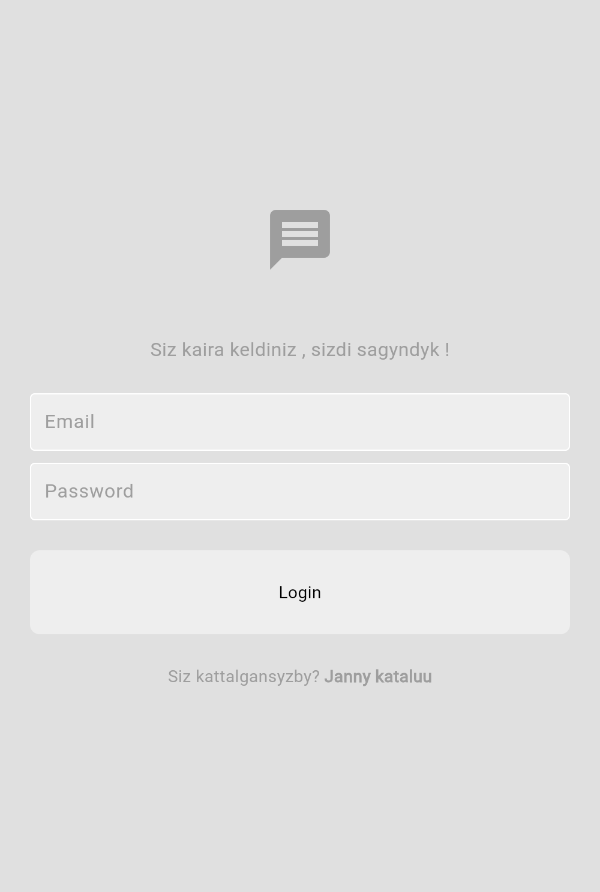

# mini_Chat

A small one-to-one chat app built with Flutter and Firebase.



## Features

- Sign up and log in with email and password (Firebase Authentication).
- A list of registered users (Cloud Firestore, `Users` collection).
- A private chat between two users; messages are stored in `chat_rooms/{id}/messages` and update live.
- Chat bubbles for your own and the other person's messages.
- Light and dark theme switch in Settings (state kept with Provider).

## Stack

Flutter, `firebase_core`, `firebase_auth`, `cloud_firestore`, `provider`.

## Project structure

```text
lib/
  main.dart            app start, Firebase init, theme provider
  services/auth/       auth gate, login or register, auth service
  services/chat/       chat service (users stream, send and read messages)
  pages/               login, register, home, settings
  components/          text field, button, user tile, chat bubble, drawer
  themes/              light and dark themes, theme provider
  models/message.dart  message model
```

## Run it

```bash
flutter pub get
flutter run
```

To use your own Firebase project, run `flutterfire configure`; it regenerates `lib/firebase_options.dart`.
